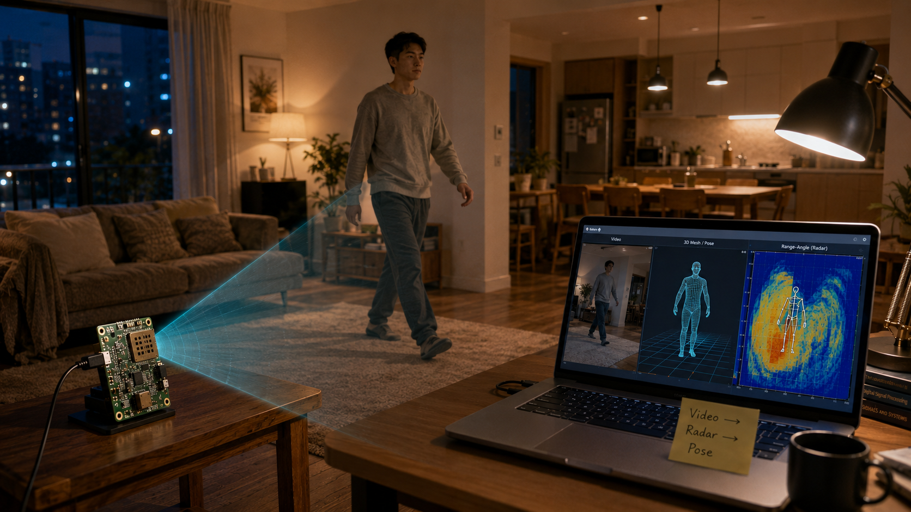

<p align="center">
  
</p>

<p align="center">
  <b>VideoRadarSim</b><br>
  <i>From ordinary video to trainable mmWave radar data — physics-first, toolbox-ready.</i>
</p>

<p align="center">
  <a href="LICENSE"></a>
  <a href="pyproject.toml"></a>
  <a href="https://github.com/DandongExpress/RadarHPE-Toolbox"></a>
  
</p>

<p align="center">
  <a href="#why-this-matters">Why</a> ·
  <a href="#what-you-get">What you get</a> ·
  <a href="#quick-start">Quick start</a> ·
  <a href="#architecture">Architecture</a> ·
  <a href="#ecosystem">Ecosystem</a> ·
  <a href="#roadmap">Roadmap</a>
</p>

---

## Why this matters

Millimeter-wave radar can sense human motion **without cameras** — privacy-preserving, illumination-invariant, and deployable on low-cost chips. It is a natural fit for eldercare, rehab monitoring, smart spaces, and any setting where continuous video is unacceptable.

But progress is bottlenecked by **data**:

| Reality today | What that costs |
|---|---|
| Real mmWave capture needs radar hardware, careful sync, and labeled pose | Weeks of lab time per environment |
| Public datasets are small, scene-specific, and hard to extend | Models overfit rooms and radar chips |
| Simulators are fragmented (Doppler-only, depth-camera dependent, paper-specific) | Every lab re-implements glue code |

**VideoRadarSim** attacks that bottleneck at the source.

> Turn the world’s abundant video into **physics-grounded, pose-labeled mmWave signals** — so researchers can train, ablate, and deploy sensing systems without waiting for another full radar collection campaign.

We are not building a black-box video-to-heatmap generator. We are building an **open, extensible physical pipeline**: video → 3D human mesh → radar scatterers → FMCW IF → Range-Angle-Doppler heatmaps, with export formats that plug into [RadarHPE-Toolbox](https://github.com/DandongExpress/RadarHPE-Toolbox).

That separation of concerns is the point: each stage can be improved independently, validated against physics, and reused across papers — instead of another one-off simulation script that dies with the paper.

---

## What you get

<table>
<tr>
<td width="50%">

**For researchers**
- Physics-guided FMCW synthesis (chirp → IF → FFT)
- TI radar profiles aligned with HuPR / XRF55 / MMVR
- Pose-labeled synthetic heatmaps for pretraining & ablation
- Export layout ready for RadarHPE-Toolbox

</td>
<td width="50%">

**For the community**
- MIT-licensed, pip-installable Python package
- Runnable demos with **no GPU and no video download**
- Documented physics assumptions & known limitations
- A path from MVP → video backends → sim-to-real

</td>
</tr>
</table>

```text
RGB Video / Mesh  →  3D Human  →  Scatterers  →  FMCW IF  →  Heatmap  →  Trainable Data
     (abundant)        (pose GT)     (physics)     (radar)     (HPE-ready)   (scale)
```

---

## Quick start

```bash
git clone https://github.com/DandongExpress/VideoRadarSim.git
cd VideoRadarSim
pip install -e .

# Phase-0 demo: synthetic human mesh → Range-Angle heatmaps (no video / GPU needed)
videoradar demo-mesh --frames 30 -o outputs/demo

# List built-in radar profiles
videoradar list-profiles
```

### Python API

```python
from videoradar import simulate_from_video

result = simulate_from_video(
    "walk.mp4",
    radar_profile="ti_iwr1843boost",  # HuPR-style profile
    output_dir="synthetic/hupr/",
)
# result.heatmaps: (T, R, A) — ready for HPE training pipelines
```

> **v0.1 note:** The core physics path (mesh → FMCW → heatmap) is working. Full video→SMPL recovery lands in v0.2; until then, the video command uses a synthetic human-motion fallback while preserving the same export format.

---

## Architecture

| Module | Role |
|--------|------|
| `videoradar.vision` | Video → 3D mesh recovery (WHAM / 4D-Humans planned) |
| `videoradar.scatter` | Mesh → radar scatterers (visibility + RCS weighting) |
| `videoradar.radar` | FMCW IF synthesis + Range / Doppler / Angle FFT |
| `videoradar.export` | RadarHPE-Toolbox–oriented bundles (`heatmaps/`, metadata, pose GT) |

Built-in profiles: `ti_iwr1843boost` · `ti_iwr6843isk` · `ti_awr2243`

Docs: [Physics assumptions](docs/physics_assumptions.md) · [Limitations](docs/limitations.md) · [Tutorials](docs/Tutorials.md) · [Roadmap](docs/roadmap.md)

---

## Ecosystem

VideoRadarSim is the **data generation** layer of a broader open stack for deployable mmWave human sensing:

| Project | Role | Venue |
|---------|------|-------|
| **VideoRadarSim** (this repo) | Video / mesh → synthetic mmWave data | Open infrastructure |
| [RadarHPE-Toolbox](https://github.com/DandongExpress/RadarHPE-Toolbox) | Unified train / eval / model zoo | Open infrastructure |
| [PPPR](https://github.com/DandongExpress/PPPR) | Physics-informed human representation | UbiComp / IMWUT 2026 |
| [PULSE](https://github.com/DandongExpress/Doppler-Prompting-for-Stable-mmWave-based-Human-Pose-Estimation) | Doppler prompting for stable pose | ICML 2026 |

```text
  Video ──► VideoRadarSim ──► Synthetic Heatmaps
                                    │
                                    ▼
                         RadarHPE-Toolbox
                         (datasets · metrics · models)
                                    │
                    ┌───────────────┼───────────────┐
                    ▼               ▼               ▼
                  PPPR            PULSE         Agile-HPE
              (representation)  (stability)   (edge preprocess)
```

If you care about **privacy-preserving sensing that survives new rooms and new radar chips**, this stack is meant to be shared ground — not another isolated paper dump.

---

## Roadmap

| Version | Focus |
|---------|--------|
| **v0.1** (now) | Mesh → FMCW → heatmap; TI profiles; Toolbox export; CLI demos |
| **v0.2** | Video→SMPL backends; simple room clutter; multipath approx; Toolbox loader |
| **v0.3** | PPPR-style joint scatterers; differentiable forward; optional sim-to-real refiner |
| **v0.4** | Real-vs-synthetic reports; multi-person; community model recipes |

See [docs/roadmap.md](docs/roadmap.md) for the full checklist.

---

## Call for collaborators

We welcome:

- Ports of new scatterer / radar / vision backends
- Real-vs-synthetic evaluation on public HPE datasets
- Industry partners who need scalable labeled radar data for health & smart-space deployment
- Tutorials, bug reports, and PRs that make the first-hour experience smoother

Open an issue before large PRs so we can align on API shape. Stars and citations help this become shared infrastructure.

---

## Citation

If you use VideoRadarSim, please **star this repository**, cite the method paper(s) corresponding to any RadarHPE models you train on the synthetic data, and consider citing [RadarHPE-Toolbox](https://github.com/DandongExpress/RadarHPE-Toolbox) when you use the shared loaders and metrics.

BibTeX for related method papers is maintained in the Toolbox README and in this repo’s [`CITATION.cff`](CITATION.cff).

---

## License

Released under the [MIT License](LICENSE).
